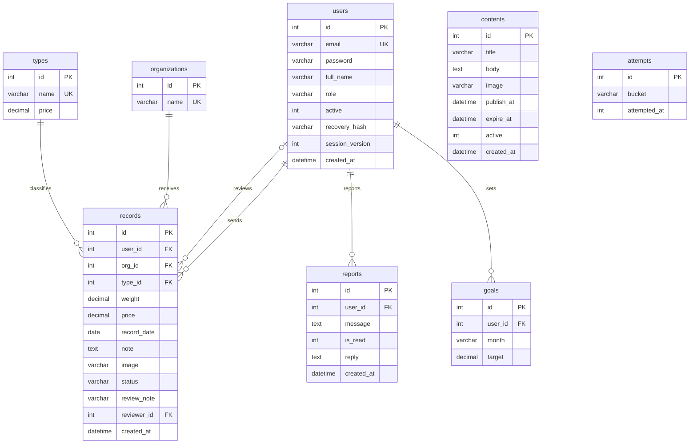

# ฐานข้อมูลและความสัมพันธ์

ฐานข้อมูลใหม่ `greendigital` ใช้ UTF-8 (utf8mb4), InnoDB และ Foreign Key น้ำหนักเก็บ DECIMAL(12,3) ราคา DECIMAL(10,2) เพื่อกำหนดความละเอียดชัดเจน คำนวณยอดรายงานจากรายการตรวจรับเท่านั้น

`contents` เป็นบทความส่วนกลาง ไม่ผูกเจ้าของรายบุคคล ส่วน `attempts` เป็นตัวนับความพยายามยืนยันตัวตน แยกออกจากข้อมูลธุรกิจ

| ตาราง | รายละเอียดสำคัญ |
|---|---|
| users | email ไม่ซ้ำ, password และ recovery_hash เก็บ hash, role = admin/staff/member, active 1/0, session_version ใช้ยกเลิก session เก่า |
| organizations | ชื่อองค์กรไม่ซ้ำ ลบไม่ได้ถ้ามี records อ้างอิง |
| types | ชื่อประเภทไม่ซ้ำ ราคาต่อกิโลกรัมไม่ติดลบ |
| records | เจ้าของ องค์กร ประเภทต้องมีจริง; reviewer_id ว่างได้ก่อนตรวจ; pending/approved/rejected; ราคาเก็บเป็น snapshot |
| contents | publish_at/expire_at ว่างได้; เวลาเปิดรวมขอบเขต เวลา expire ไม่นับรวม |
| reports | ผู้แจ้งต้องมีจริง; is_read เปลี่ยนเมื่อเจ้าหน้าที่ตอบ; เก็บข้อความเดิมไว้ |
| goals | unique(user_id,month) ทำให้หนึ่งคนมีเป้าหมายได้หนึ่งค่าต่อเดือน |
| attempts | bucket เป็น SHA-256 ของประเภทงานกับตัวระบุ; เก็บเฉพาะช่วง 15 นาทีล่าสุดเมื่อมีการตรวจ |

ไฟล์ SQL เป็นแหล่งอ้างอิงชื่อฟิลด์และชนิดข้อมูลที่แน่นอน Diagram แสดงเฉพาะฟิลด์หลักของ users; phone/address อยู่ใน SQL ด้วย

## กฎข้อมูลที่ต้องรักษา

- ผู้ใช้ทั่วไปอ่านหรือแก้ records/reports ของผู้อื่นไม่ได้ แม้เปลี่ยน ID เอง
- สมาชิกส่งสถานะอนุมัติหรือ user_id มาก็ไม่มีผล ค่าเหล่านี้กำหนดที่ PHP
- รายการ approved แก้หรือลบไม่ได้จนเจ้าหน้าที่คืนสถานะ pending
- ทุกน้ำหนักใช้กิโลกรัม ไม่มีการรวมหน่วยชิ้นกับกิโลกรัม
- ภาพเก็บชื่อสุ่มใน storage; API ตรวจเจ้าของหรือสิทธิ์แสดงเนื้อหาก่อนส่งภาพ
- ไม่ลบสมาชิก เพราะข้อมูลประวัติอ้างอิงอยู่ ใช้การระงับแทน
- การแก้ราคาประเภทไม่ย้อนเปลี่ยนราคาของ records เดิม; การแก้รายการที่ยังไม่ตรวจรับจะบันทึกราคาปัจจุบัน

## ตัวอย่างคำนวณด้วยมือ

ขวดพลาสติก 12.5 กก. × 8 บาท = 100 บาท
กระดาษ 20 กก. × 4 บาท = 80 บาท
ถ้าทั้งสองรายการตรวจรับแล้ว ยอด = 32.5 กก. / 180 บาท
ถ้ารายการกระดาษยัง pending ยอด = 12.5 กก. / 100 บาท

คะแนนเดือนปัจจุบันของสมาชิก = floor(น้ำหนัก approved ในเดือน × 10)
ความสำเร็จเป้าหมาย = min(100, น้ำหนัก approved ในเดือน / เป้าหมาย × 100)

ไม่มีตารางธุรกรรมจ่ายเงินหรือค่าคำนวณ CO₂ เพราะไม่ได้ดำเนินการชำระเงินจริงและไม่ได้กำหนดปัจจัยการปล่อยคาร์บอน
